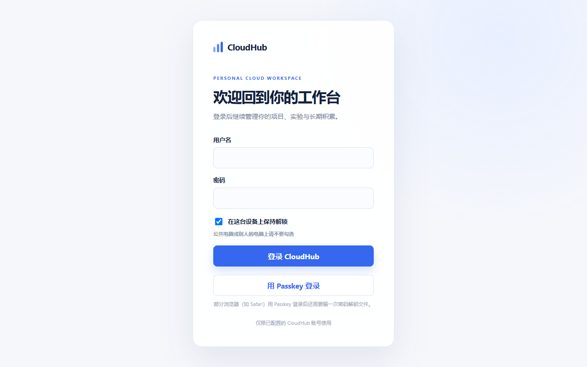
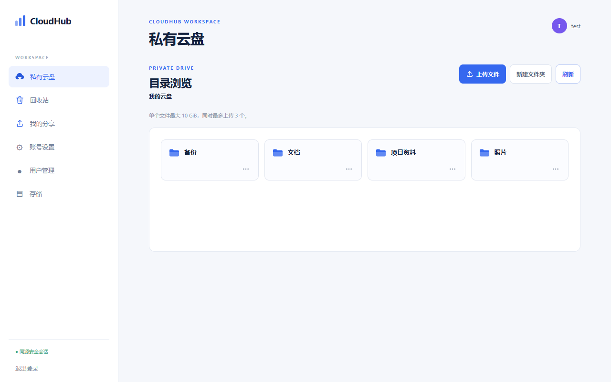
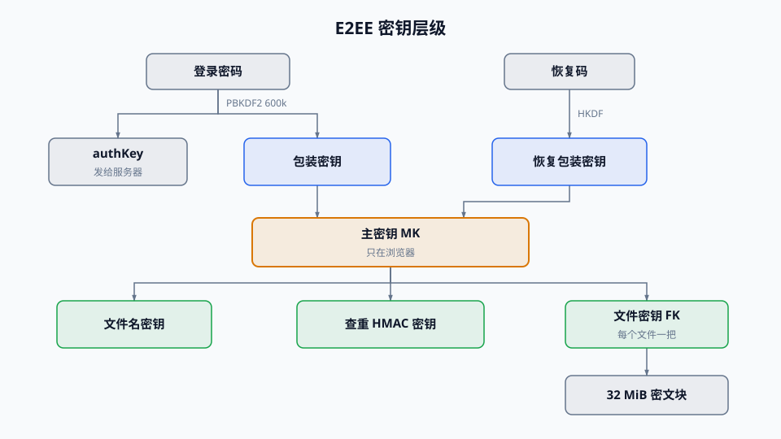
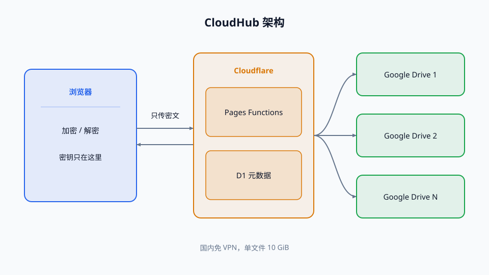
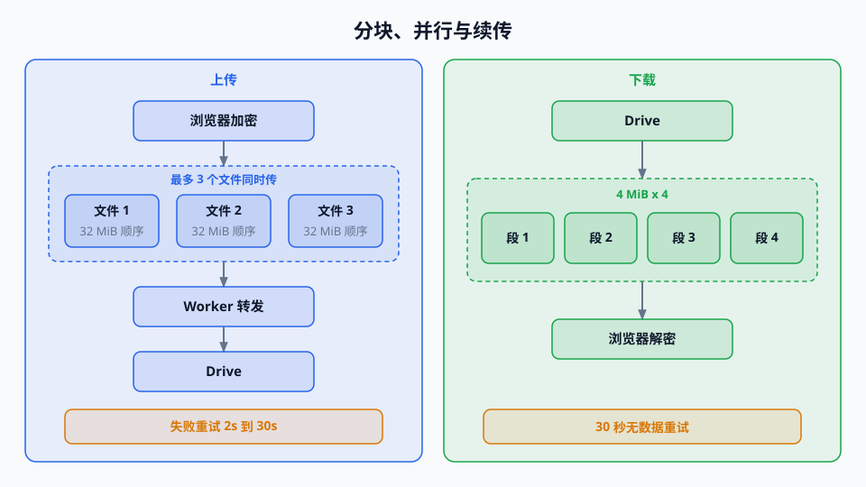

# CloudHub

给少数人用的私有云盘：端到端加密，跑在 Cloudflare Pages 上。

| 登录 | 云盘 |
| :---: | :---: |
|  |  |

浏览器只和 Cloudflare 通信，由 Pages Functions 去连 Google Drive，所以在访问不了 Google 的网络里也能用（前提是你的自定义域名能访问）。

## 功能

- **账号**：没有公开注册，账号由管理员创建。新账号首次登录时设置密码和恢复码。
- **端到端加密**：文件内容、文件名、目录名都在浏览器里用主密钥加密后才上传；服务器和管理员都看不到明文，也看不到密码和密钥。忘记密码只能用恢复码找回文件。
- **两步验证**：支持 TOTP（RFC 6238），兼容常见的验证器 App，附带一次性恢复码。管理员可以给普通用户重置两步验证。
- **Passkey**：可以用 Windows Hello、手机或安全密钥登录，每人最多 10 个。认证器支持 PRF 扩展时（如 Chrome / Edge）登录后直接解锁文件；不支持时（如 Safari）只负责登录，之后还要输一次密码解锁。Passkey 登录不再要求 TOTP。
- **多账号存储**：管理员可以在工作台的「存储」页添加多个 Google 账号，把空间串起来。每个文件只存在一个账号上，上传时自动选剩余空间最大的账号；账号可以设为只读、重新授权或移除。
- **上传**：单个文件最大 10 GiB，按 32 MiB 分片，经 Functions 中转给 Google Drive 的断点续传会话。最多同时上传 3 个文件，每个文件的分片按顺序传。网络错误、429 和 5xx 会自动重试（最多重试 6 次，间隔 2 秒到 30 秒），可以暂停后继续，断线后从已收到的字节接着传。传完校验大小并记录 Google 返回的 MD5。支持拖拽。
- **下载**：密文按 4 MiB 分段、4 段并发下载，在浏览器里解密后保存。某一段 30 秒没有数据或失败会自动重试，最后校验总大小。Chrome / Edge 可以边下边存。
- **限额提示**：免费额度用完、Google 账号需要重新授权、空间不足时，界面会说明原因和恢复时间，不会只显示「未知错误」。
- **文件管理**：目录、重命名、移动。目录树只存在 D1 里，重命名和移动不会动 Drive 上的文件。
- **回收站**：删除的文件保留 30 天，可以恢复、彻底删除或清空。
- **分享链接**：随机 token，库里只存哈希，可以设过期时间、随时撤销，有下载计数。文件密钥放在链接 `#` 后面。

## 安全模型



服务器能看到和看不到什么：

- **服务器能看到**：用户名、文件大小、目录结构（哪些文件属于哪个目录，但不含名称）、上传时间、分享次数。
- **服务器看不到**：文件内容、文件名、目录名、你的密码、你的主密钥和恢复码。

几个具体设计：

- 会话放在 HttpOnly Cookie 里，写操作校验同源 `Origin`/`Referer`。
- Google 的 refresh token 和 TOTP 密钥用 AES-GCM 加密后存进 D1，加密密钥放在 Pages 的 secret 里。
- 登录失败次数有上限，TOTP 有防重放，恢复码只能用一次。
- 密码在浏览器里用 PBKDF2（600,000 次）派生出加密密钥和登录密钥，只把登录密钥发给服务器；服务器再用 PBKDF2（100,000 次，Workers 的上限）哈希后存储，不存密码本身。
- Passkey 不引入第三方库，用 WebCrypto 验签，只接受 ES256 和 RS256。challenge 5 分钟有效、只能用一次；签名计数回退会被拒绝。支持 PRF 时，PRF 输出经 HKDF 派生出一把包装密钥来加密主密钥，服务器只存加密后的结果。
- 管理员重置某人的密码后，该用户的 Passkey 全部删除；用户重置加密密钥后，旧 Passkey 只能登录、不能再解锁。

「在这台设备上保持解锁」的含义：勾选后，浏览器会生成一把只存在这台设备上的钥匙，用它把主密钥加密后存进浏览器的本地存储。下次打开或刷新页面时不用重新输入密码。公共电脑或别人的电脑上请不要勾选。

分享链接：`#` 后面带着文件密钥，谁拿到完整链接谁就能打开对应的文件，所以不要把链接公开转发。

## 限制

- Cloudflare Pages 免费计划额度：每天 10 万次请求，北京时间 08:00 重置；单个请求 CPU 时间 10 ms；单个请求体 100 MB；D1 每天读 500 万行、写 10 万行，存储 5 GB。
- 单个文件不能超过某一个 Google 账号的剩余空间（文件只会存在一个账号上）。
- 只有 Chrome / Edge 能边下边存大文件，其他浏览器需要先把整块数据缓存在内存里，大文件可能失败。
- 国内访问 Cloudflare 免费线路速度有限，晚高峰可能更慢。

## 架构



D1 里存用户、会话、两步验证、Passkey、目录树（名称已加密）、上传会话、回收站、分享和存储账号；Google Drive 里只有以文件 id 命名的密文。



| 部分 | 技术 |
| --- | --- |
| 前端 | React 19 + Vite（`src/`） |
| API | Cloudflare Pages Functions（`functions/api/`） |
| 元数据 | Cloudflare D1（`migrations/`） |
| 文件内容 | Google Drive，OAuth 只申请 `drive.file` 权限 |

## 本地开发

需要 Node.js 22.6+（测试用到 `--experimental-strip-types`）和 pnpm。

```bash
pnpm install
pnpm exec wrangler d1 migrations apply cloudhub-db --local
node --experimental-strip-types scripts/init-local-test-user.mjs
pnpm build
pnpm exec wrangler pages dev dist
```

打开 `http://127.0.0.1:8788/`。单独运行 `pnpm dev` 只会启动 Vite 前端，没有 API 和数据库。

本地 secret 写在 `.dev.vars` 里，这个文件已被 git 忽略：

```ini
GOOGLE_CLIENT_ID=...
GOOGLE_CLIENT_SECRET=...
STORAGE_ENCRYPTION_KEY=...   # 32 字节随机数，base64 编码
```

注意：本地的 workerd 可能连不上 Google，存储相关功能建议在线上验证。

## 部署

1. 在 Cloudflare 创建 D1 数据库 `cloudhub-db`，创建 Pages 项目并绑定为 `DB`。
2. **先迁移，再部署代码**：`pnpm exec wrangler d1 migrations apply cloudhub-db --remote`。
3. 在 Pages 项目里设置 `GOOGLE_CLIENT_ID`、`GOOGLE_CLIENT_SECRET`、`STORAGE_ENCRYPTION_KEY` 这三个 secret。
4. 在 Google Cloud 创建 OAuth 客户端，回调地址填 `https://<你的域名>/api/storage/callback`，然后把应用发布为正式版。
5. 创建第一个管理员：运行 `node --experimental-strip-types scripts/create-user-sql.mjs --username admin --role admin`，按提示输入密码。脚本会把建号 SQL 写到 `.tmp/create-user.sql` 并打印恢复码，把恢复码保存好，再用脚本打印出的命令把 SQL 写进线上数据库。
6. 用管理员登录后，在工作台的「存储」页添加 Google 账号，按提示授权。

`drive.file` 权限只能访问 CloudHub 自己创建的文件，属于非敏感权限，所以 OAuth 应用可以直接发布，不用经过 Google 审核，也不会遇到测试模式下 refresh token 7 天过期的问题。

## 测试

```bash
pnpm test:functions
pnpm test:frontend
pnpm lint
pnpm exec tsc -p tsconfig.functions.json --noEmit
```

`pnpm build` 只检查前端类型，Functions 的类型要用最后一条命令单独检查。

## 致谢

下面这些项目在设计上给了启发。CloudHub 只参考了思路，没有复制它们的代码。

- [mizorewww/gdirect](https://github.com/mizorewww/gdirect)（GPL-2.0）：用自己的 OAuth 客户端接自己的 Google 账号；发布 OAuth 应用来避开 refresh token 7 天过期；断点续传上传和 Range 下载
- [longern/FlareDrive](https://github.com/longern/FlareDrive)（MIT）及其分支 [sagan/FlareDrive](https://github.com/sagan/FlareDrive)：在 Cloudflare 上做网盘的整体思路，以及上传客户端的并发和失败重试
- [cloudflare/workerd#1346](https://github.com/cloudflare/workerd/issues/1346)：确认了 Workers 上 PBKDF2 迭代次数的上限

## 许可

[MIT](LICENSE)
