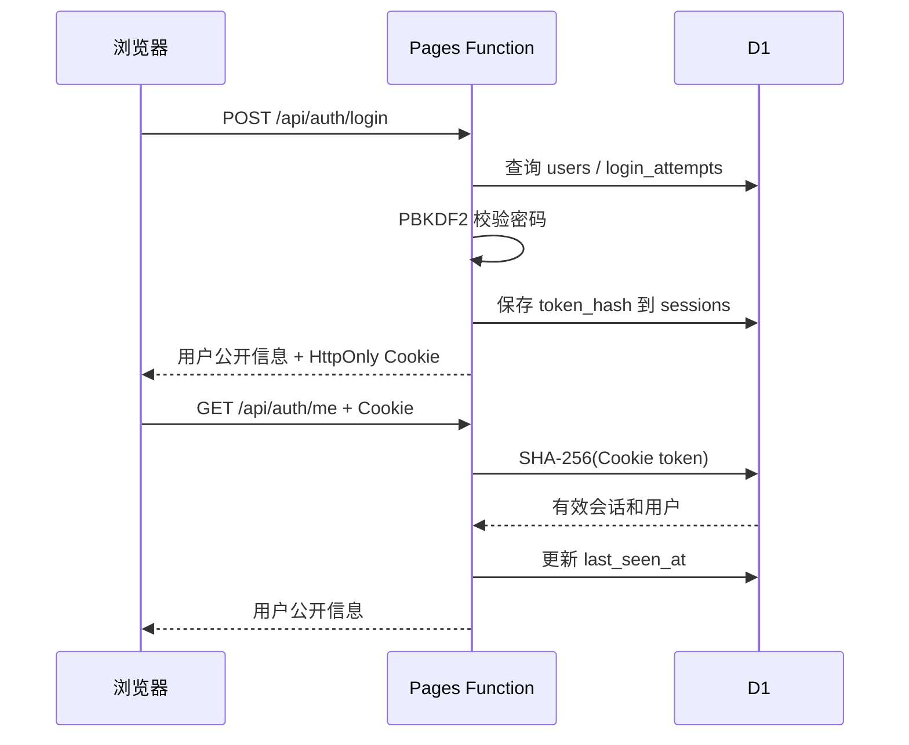
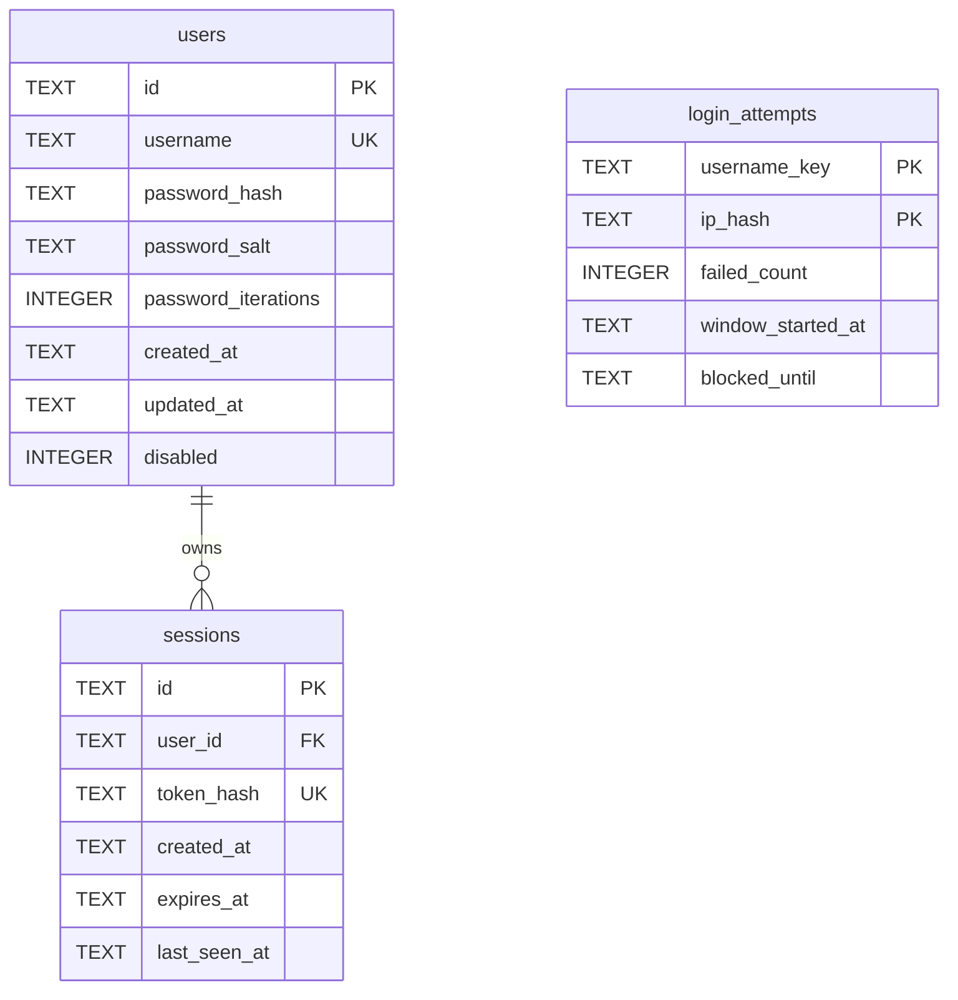

# 当前架构与认证实现

## 1. 运行链路



## 2. 认证相关文件

| 文件 | 作用 |
| --- | --- |
| [functions/_lib/auth.ts](../../functions/_lib/auth.ts) | 密码、会话、Cookie、限流和认证查询 |
| [functions/_lib/http.ts](../../functions/_lib/http.ts) | JSON 响应、同源校验和统一安全头 |
| [functions/api/auth/login.ts](../../functions/api/auth/login.ts) | 登录 |
| [functions/api/auth/me.ts](../../functions/api/auth/me.ts) | 当前用户 |
| [functions/api/auth/logout.ts](../../functions/api/auth/logout.ts) | 当前会话退出 |
| [functions/api/auth/logout-all.ts](../../functions/api/auth/logout-all.ts) | 当前用户全部会话撤销 |
| [functions/api/health.ts](../../functions/api/health.ts) | D1 健康检查 |
| [migrations/0001_auth.sql](../../migrations/0001_auth.sql) | D1 认证表迁移 |
| [wrangler.jsonc](../../wrangler.jsonc) | 本地 D1 绑定和迁移目录 |

## 3. D1 表结构



### `users`

只存密码派生结果、盐值和迭代次数，不存明文密码。

### `sessions`

Cookie 中保存原始令牌，D1 只保存令牌的 SHA-256 哈希。会话有效期为 7 天，查询时检查过期和账号禁用状态。

### `login_attempts`

按用户名和客户端 IP 的哈希记录失败次数。IP 只用于辅助限流，不是身份认证依据。

## 4. API 行为

### `POST /api/auth/login`

请求：

```json
{
  "username": "本地账号名",
  "password": "密码"
}
```

成功返回：

```json
{
  "user": {
    "id": "user-id",
    "username": "username"
  }
}
```

并设置：

```text
HttpOnly; Secure; SameSite=Strict; Path=/; Max-Age=604800
```

### `GET /api/auth/me`

- 有效会话：`200`
- 未登录、过期或禁用：`401`
- 不返回密码、盐、哈希或令牌

### `POST /api/auth/logout`

- 同源校验
- 删除当前会话
- 清除 Cookie

### `POST /api/auth/logout-all`

- 同源校验
- 验证当前会话
- 删除当前用户的全部 `sessions`
- 不需要数据库迁移

## 5. 当前安全边界

当前认证解决的是“谁可以调用 API”，不解决“文件内容是否只有用户能解密”。

```text
认证已实现
    ≠
文件授权已实现
    ≠
文件加密已实现
```
