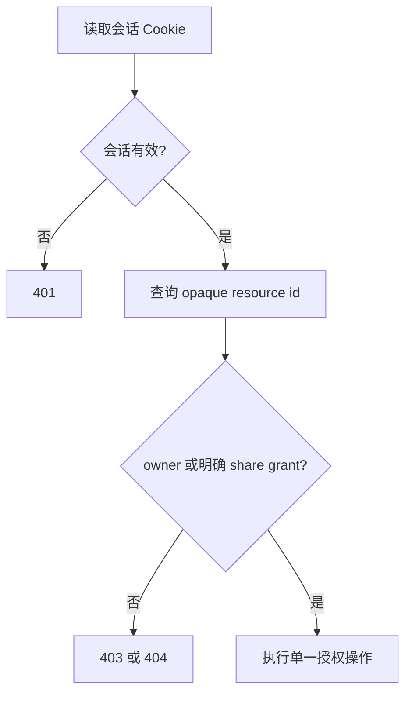

# 安全审计与风险清单

## 1. 审计结论

当前认证基础没有发现已实现代码中的高危漏洞，但 CloudDrive 的关键资源安全能力尚未实现。进入文件功能开发前，必须优先补齐资源授权、缓存控制、Blob 访问控制和加密方案。

## 2. 风险分级

| 等级 | 风险 | 当前状态 | 处理建议 |
| --- | --- | --- | --- |
| 🟡 中 | 认证响应可能被错误缓存 | 已通过 `jsonResponse()` 统一 `no-store` 加固 | 上线后用线上响应头复核 |
| 🟡 中 | 未来文件 API 的 IDOR | 文件 API 尚未实现 | 所有资源查询强制 owner/share 校验 |
| 🟡 中 | Azure Blob 凭据暴露 | Azure 尚未接入 | 只由服务端签发短时、单对象 SAS |
| 🟡 中 | 文件内容无 E2EE | 尚未实现 | 采用客户端 AES-256-GCM |
| ⚪ 低 | 安全响应头与部署配置脱节 | 已新增 `public/_headers` | Pages 线上验证 CSP/HSTS |
| ⚪ 低 | 缺少密码修改和会话管理 UI | 尚未实现 | 后续增加密码变更和全量撤销入口 |

## 3. 已检查项目

### XSS

当前首页为静态 React 数据，没有发现：

- `dangerouslySetInnerHTML`
- 动态 HTML 拼接
- 用户可控 URL

未来文件名、描述、标签、分享备注必须继续使用 React 默认转义。

### SQL 注入

认证 API 使用 D1 参数绑定，没有将用户名、IP 或 Cookie 直接拼接进 SQL。

### Cookie 与 CSRF

当前 Cookie 使用：

```text
HttpOnly
Secure
SameSite=Strict
Path=/
```

状态变更接口 login、logout、logout-all 要求同源 `Origin` 或 `Referer`。`me` 为只读查询，不执行状态变更。

### 路径穿越

当前没有文件路径或 Blob key 处理，因此暂未出现实际路径穿越漏洞。未来 Blob key 必须由服务端生成，不能使用用户原始文件名拼接。

### IDOR

当前没有文件资源接口，因此暂未出现实际 IDOR。未来所有 API 必须执行：



## 4. Azure Blob 安全边界

当前仓库没有 Azure SDK、Blob API、SAS 或密钥，因此 Azure 安全能力仍是“未实现”。

禁止暴露给浏览器：

- Storage Account Key
- Connection String
- 长期 SAS
- Azure Client Secret

推荐：

- 私有容器
- Managed Identity 或 Workload Identity
- 服务端授权后签发短时、单对象、单操作 SAS
- Blob key 使用服务端生成的 opaque ID
- 开启 Blob versioning、soft delete 和恢复演练

## 5. 进入文件开发前的检查清单

- [ ] 认证接口线上响应包含 `Cache-Control: no-store`
- [ ] Pages 静态响应包含 CSP、HSTS 和防嵌套策略
- [ ] 文件表存在 owner 字段和 opaque ID
- [ ] 所有文件操作使用共享授权函数
- [ ] 不接受客户端 owner ID 或 Blob key
- [ ] 上传/下载能力短时、单对象、单操作
- [ ] 文件名和敏感元数据不直接作为 Blob key
- [ ] 失败、删除、分享和恢复均有审计事件
