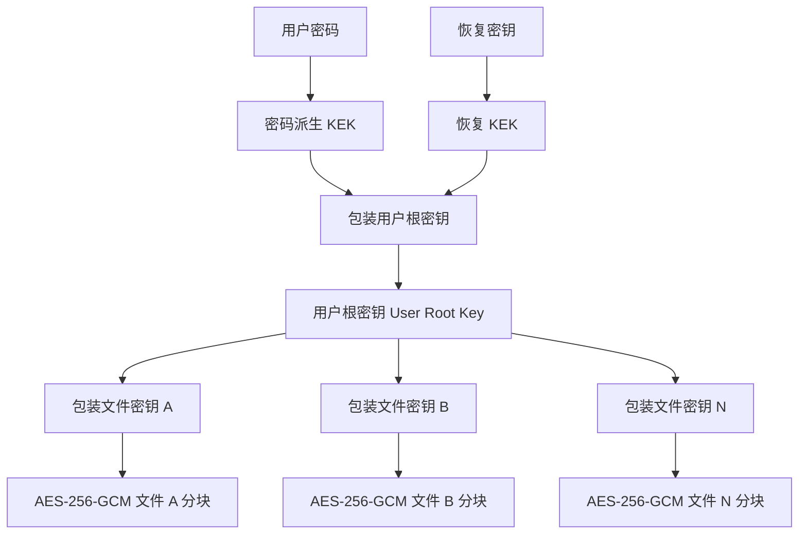
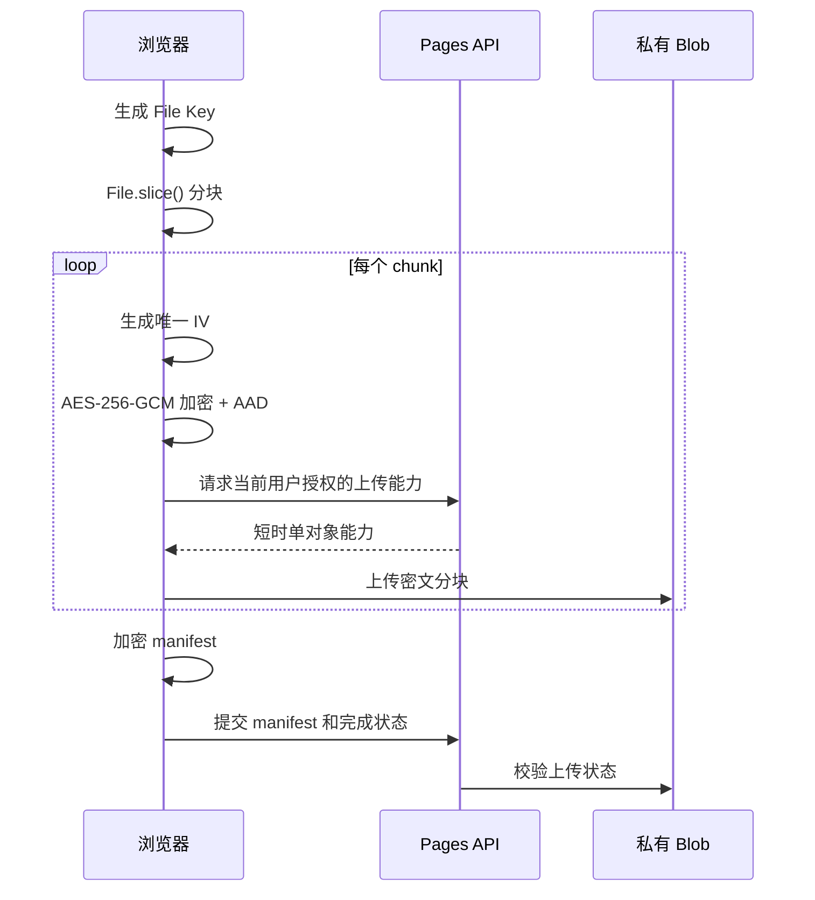
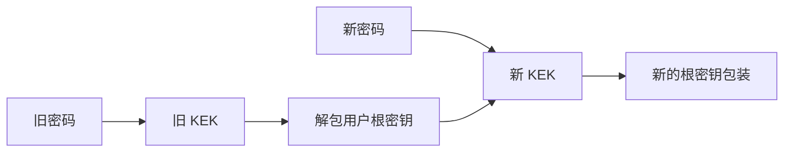

# 客户端端到端加密方案

> [!WARNING]
> 本文是设计笔记，不代表当前仓库已经实现 AES-GCM、文件加密、恢复密钥或加密上传。

## 1. 目标

CloudDrive 的长期目标是：云端保存文件密文，Cloudflare、D1、Azure Blob 管理员和普通服务端流程不能直接解密文件内容。

## 2. 推荐密钥层级



### 关键规则

- 每个用户拥有独立用户根密钥
- 每个文件版本生成独立随机 256-bit 文件密钥
- 同一个 AES-GCM 密钥下，IV 绝不重复
- 根密钥不进入 localStorage、URL、普通日志或服务端明文数据库
- 密钥轮换优先重新包装文件密钥，而不是重新加密所有内容

## 3. 文件加密流程



## 4. 分块建议

- 建议块大小：4–16 MiB
- 使用 `Blob.slice()` 或 `File.stream()`
- 不把整个大文件读入内存
- 每个块包含：
  - `chunk_index`
  - `total_chunks`
  - `chunk_size`
  - `iv`
  - `ciphertext`
  - GCM authentication tag
- AAD 至少包含：

```text
format_version
file_id
file_version_id
chunk_index
total_chunks
file_key_id
```

这样可以检测：

- 分块重排
- 分块丢失
- 分块重复
- 密文替换
- manifest 与内容不匹配

## 5. 加密文件格式

建议使用可升级的版本化格式：

```text
magic: "CHB1"
format_version: 1
algorithm: "AES-256-GCM"
chunk_size
total_plaintext_size
chunk_count
file_key_id
encrypted_manifest
wrapped_file_key
chunk_metadata[]
```

服务器可见的运营元数据尽量减少为：

```text
opaque_file_id
owner_id
ciphertext_size
created_at
updated_at
encryption_version
```

以下字段建议放入加密 manifest：

- 原始文件名
- MIME 类型
- 文件夹名
- 描述
- 标签
- 分享备注

即使加密元数据，文件大小、对象数量、上传时间和访问频率仍可能泄露。

## 6. 恢复、修改密码和轮换

### 修改密码



不需要重新加密所有文件。

### 恢复密钥

- 浏览器端生成恢复密钥
- 用户离线保存或导出加密备份
- 服务端不保存恢复密钥明文
- 丢失密码和恢复材料意味着永久数据丢失

### 文件密钥轮换

- 普通密码变更：重新包装用户根密钥
- 分享撤销：删除授权包装密钥
- 强撤销：轮换文件密钥并重新加密后续版本

## 7. 两个账号的隔离

```text
User A Root Key != User B Root Key
```

默认情况下，A 和 B 不能互相解包文件密钥。共享文件时：

1. 校验文件所有者
2. 为接收用户单独包装 File Key
3. 创建显式 share grant
4. 撤销分享时删除对应包装密钥
5. 需要强撤销时轮换 File Key

## 8. 方案 A 与方案 B

| 项目 | A：客户端 E2EE | B：服务端/Key Vault |
| --- | --- | --- |
| 云端能否解密 | 不能 | 可以 |
| 管理员读取风险 | 低 | 依赖权限和审计 |
| 密码丢失恢复 | 依赖恢复密钥 | 平台恢复能力更强 |
| 服务端预览/搜索 | 复杂 | 容易 |
| 浏览器开发成本 | 高 | 中 |
| 推荐场景 | 高敏感私密资料 | 必须服务端处理内容 |

针对商业资料，推荐方案 A。若业务必须支持服务端全文搜索、预览或管理员恢复，再评估方案 B。
