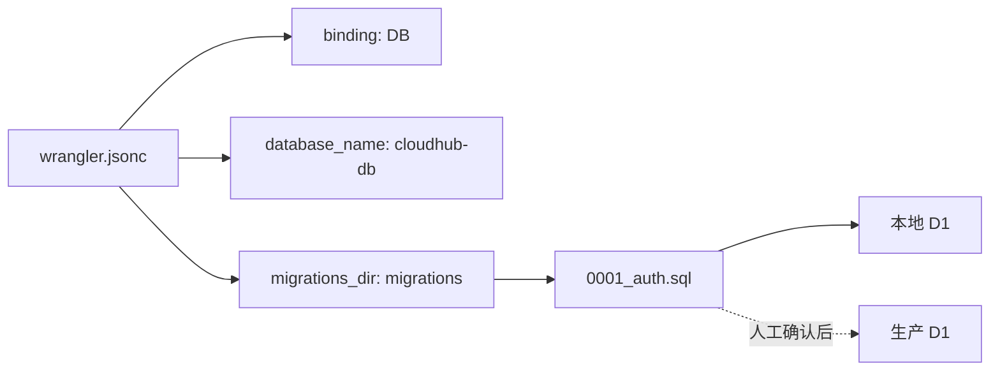

# D1 与生产运维手册

## 1. 配置关系



## 2. 本地迁移

当前 Wrangler 已作为开发依赖安装。执行本地迁移：

```bash
pnpm exec wrangler d1 migrations apply cloudhub-db --local
```

本地只读核对：

```bash
pnpm exec wrangler d1 execute cloudhub-db --local --command "SELECT name, type FROM sqlite_master WHERE type = 'table' AND name IN ('users', 'sessions', 'login_attempts') ORDER BY name;"
pnpm exec wrangler d1 execute cloudhub-db --local --command "SELECT * FROM d1_migrations ORDER BY applied_at;"
```

预期表：

```text
login_attempts
sessions
users
```

## 3. 生产迁移前核对

生产迁移状态不能由本地记录推断。执行前人工确认：

- 当前 Cloudflare 登录账号
- Pages 项目名称
- Pages 项目的 D1 绑定变量 `DB`
- D1 实际数据库名称
- D1 数据库 ID
- 当前 Git 提交和迁移文件内容
- 迁移是否已经在生产执行

如果无法确认目标数据库，不执行迁移。

## 4. 生产迁移命令

仅在人工确认目标后执行：

```bash
pnpm exec wrangler d1 migrations apply cloudhub-db --remote
```

本仓库的自动化流程禁止自行执行该命令。

不要用 `d1 execute` 绕过迁移记录，也不要手工重复执行迁移 SQL。

## 5. 固定账号初始化

凭据生成脚本：

```bash
node scripts/generate-password-hash.mjs
```

要求：

- 交互式输入
- 密码不作为命令行参数
- 密码不回显
- 不提交真实 seed 文件
- 不放入 `VITE_*`
- 不写入日志

本地临时文件必须被 `.gitignore` 忽略：

```text
cloudhub-auth-seed.local.sql
.dev.vars
.dev.vars.*
```

不要把 [scripts/auth-seed.example.sql](../../scripts/auth-seed.example.sql) 的占位模板直接当作生产账号初始化文件。

## 6. 禁止事项

- 不在本地验证时使用 `--remote`
- 不把数据库 ID 猜写进配置
- 不执行未审查的 seed SQL
- 不在构建命令中自动迁移生产 D1
- 不把 Azure 密钥、SAS 或密码写进源码
- 不把 `.wrangler/` 本地状态提交到 Git
