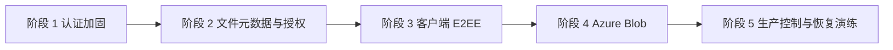
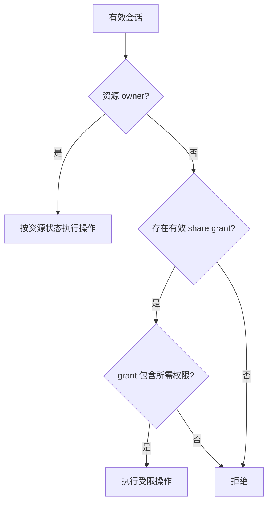

# 阶段路线图与测试矩阵

## 1. 推荐实施顺序



## 2. 阶段 1：认证安全加固

当前已完成：

- 认证响应 `Cache-Control: no-store`
- API 基础安全头
- login 同源校验
- logout 同源校验
- logout-all 全量会话撤销
- 静态 Pages `_headers`

仍需线上验证：

- Cloudflare Pages 实际响应头
- HSTS 是否适合当前域名和子域名
- CSP 是否与未来外部资源兼容

## 3. 阶段 2：文件元数据与授权

建议表：

```text
files
file_versions
file_shares
upload_sessions
```

最低权限模型：



必测：

- A 读取 B 的文件失败
- A 修改 B 的文件失败
- A 删除 B 的文件失败
- 伪造 owner ID 失败
- 伪造 Blob key 失败
- 分享撤销后访问失败
- 过期上传会话失败

## 4. 阶段 3：客户端 E2EE

必测：

- 每块 IV 唯一
- 错误密钥无法解密
- 修改任意密文块失败
- chunk 重排失败
- chunk 截断失败
- manifest 替换失败
- 文件名不出现在 Blob key
- 密码修改后文件仍可解密
- 恢复密钥可以恢复
- 丢失恢复材料有明确失败提示
- 大文件不一次性读入内存

## 5. 阶段 4：Azure Blob

必测：

- 私有容器不能匿名读取
- SAS 只允许单对象
- SAS 只包含单一操作权限
- SAS 过期后不可用
- SAS 不能访问其他对象
- Blob versioning 和 soft delete 可恢复
- 上传中断可恢复
- 内容大小和完整性可验证

## 6. 阶段 5：生产控制

- Cloudflare、Azure、D1、Key Vault 权限分离
- 管理员访问审查
- 生产迁移审批
- 备份与恢复演练
- 密钥轮换演练
- Key Vault 不可用演练
- 外部渗透测试
- 安全事件响应流程

## 7. 完成定义

CloudDrive 只有在以下项目全部通过后，才应被描述为“私密云盘”：

```text
认证
  + 资源级授权
  + 私有 Blob
  + 短时最小权限访问
  + 客户端加密
  + 恢复密钥
  + 损坏/中断恢复
  + 删除和版本恢复
  + 跨用户安全测试
  + 线上响应头验证
```

当前阶段只能描述为：

> CloudHub 已具备双固定用户认证基础，CloudDrive 私密文件能力尚未实现。
