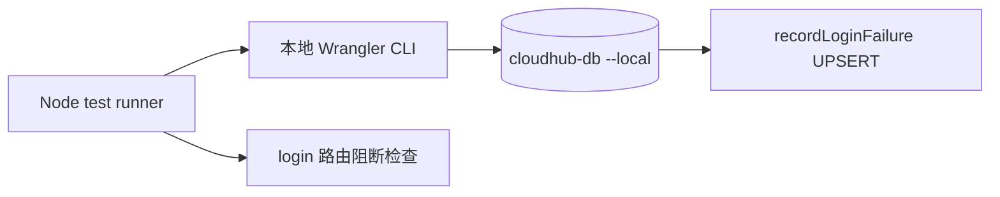

# 本地 D1 集成测试记录

## 1. 目的与范围

本测试用于验证登录失败限流的实际 D1/SQLite SQL 行为，重点是
[createD1AuthRepository](../functions/_lib/d1-auth-repository.ts) 中的
`recordLoginFailure()`。

测试不访问生产 D1，也不验证 Cloudflare 生产环境的并发调度保证。它只验证
Wrangler 本地 D1 数据库执行真实 SQL 时的结果。



## 2. 如何运行

项目已经在 [package.json](../package.json) 的 `test:functions` 中包含
`functions/**/*.test.ts`，因此默认函数测试会包含本集成测试：

```bash
pnpm run test:functions
```

只运行本地 D1 集成测试：

```bash
node --experimental-strip-types --test functions/_lib/d1-auth-repository.integration.test.ts
```

测试依赖 [wrangler.jsonc](../wrangler.jsonc) 中的本地 D1 名称
`cloudhub-db`。测试和并发辅助脚本中的 Wrangler 命令都带有 `--local`：

```text
pnpm exec wrangler d1 execute cloudhub-db --local --file=<temporary-sql-file>
```

Windows 环境使用临时 SQL 文件而不是把多行 SQL 直接作为命令行参数传递，
以避免 shell 拆分参数。临时文件在每次命令结束后删除。

## 3. 测试隔离

测试使用随机 UUID 生成用户名和 IP 哈希维度，并在每个测试前清理对应的
`login_attempts` 记录。测试结束时再次清理。

这不会删除其他本地账号或限流记录，也不会执行 seed SQL。测试仍然使用
当前本地 `cloudhub-db`，因此运行前应确认没有其他进程同时修改同一个本地
Wrangler 状态目录。

并发场景通过
[scripts/d1-record-login-failure.mjs](../scripts/d1-record-login-failure.mjs)
调用真实 repository。Wrangler 本地 CLI 并发访问 SQLite 可能返回
`SQLITE_BUSY` 或内部锁错误；辅助脚本只对这两类本地竞争错误进行有限重试，
不会将其他错误转换为成功。

## 4. 已覆盖场景

| 场景 | 验证内容 |
| --- | --- |
| 首次失败 | 新记录的计数为 `1`，阻断时间为空 |
| 窗口内失败 | 15 分钟窗口内计数递增 |
| 第五次失败 | 达到 `5` 次后设置 15 分钟阻断 |
| 已阻断的登录请求 | login 路由返回既定 `401`，不会额外写入一次失败 |
| 窗口边界 | `14:59.999` 仍在窗口内，恰好 `15:00` 重置窗口 |
| 阻断过期 | 阻断结束后可以开始新的失败窗口 |
| 并发记录 | 8 个并发记录不会造成计数丢失 |
| 活跃阻断期间直接记录 | 直接再次调用 repository 时会按本次时间重新计算阻断结束时间 |

窗口差值使用 `ROUND(julianday(...) * 86400000)`，避免 SQLite
`julianday()` 浮点表示使恰好 15 分钟被误判为窗口内。阻断时间使用带
`Z` 的 UTC 字符串，避免运行环境按本地时区解析无时区 SQLite 时间。

## 5. 并发保证边界

当前 D1 适配器使用单条
`INSERT ... ON CONFLICT(username_key, ip_hash) DO UPDATE`。因此失败计数的
更新不再依赖应用层“读取后写回”，本地测试可以验证并发写入不会丢失已提交
的计数更新。

这不等同于整个登录限流判定严格线性化：

1. login 路由先读取限流记录并判断是否阻断；
2. 多个请求可能在同一时间通过这个预检查；
3. 之后各请求才进行密码校验和失败记录；
4. repository 的单条 UPSERT 是原子的，但预检查、密码校验和写入不是一个
   跨请求的原子闸门。

另外，直接调用 `recordLoginFailure()` 时，如果更新后的失败计数仍达到阈值，
SQL 会使用本次 `now` 重新计算 `blocked_until`，所以可能延长已有阻断。
正常 login 路由在已识别为阻断时会提前返回，不会为该请求再次记录失败。

迁移到 PostgreSQL 时必须保留失败窗口、阈值、阻断时长、用户名/IP 维度和
原子更新语义，并使用真实 PostgreSQL 并发测试重新验证；本测试不能替代该
验证，也不能证明 Cloudflare 生产 D1 的完整并发行为。

## 6. 验证记录

当前本地验证结果：

```text
node --experimental-strip-types --test functions/_lib/d1-auth-repository.integration.test.ts
21 passed, 0 failed
```

新增的阻断延长场景单独验证：

```text
1 passed, 0 failed
```

相关检查还包括：

```bash
pnpm run build
pnpm run lint
pnpm exec tsc -p tsconfig.functions.json
pnpm run test:functions
git diff --check
```

这些命令不包含生产迁移、远程 Wrangler 操作或部署。
