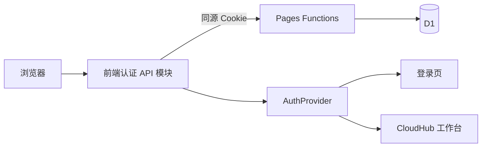
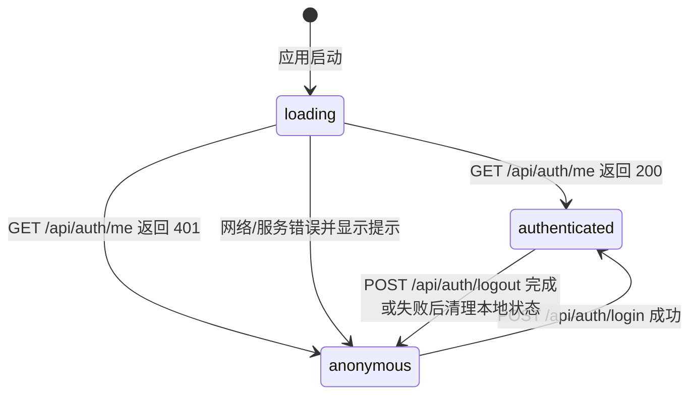

# 阶段一：登录闭环与应用主框架

## 1. 目标与范围

本阶段在现有 Cloudflare Pages + React + TypeScript 项目上完成第一个可运行
的产品切片：



本阶段没有迁移 FastAPI、PostgreSQL 或文件存储，也没有修改生产 D1。

## 2. 前端边界

| 文件 | 作用 |
| --- | --- |
| [src/api/auth.ts](../src/api/auth.ts) | 集中调用 `/api/auth/me`、`/api/auth/login` 和 `/api/auth/logout` |
| [src/auth/AuthProvider.tsx](../src/auth/AuthProvider.tsx) | 管理会话恢复、登录、退出和认证状态 |
| [src/auth/auth-context.ts](../src/auth/auth-context.ts) | 认证状态类型和 Context |
| [src/auth/useAuth.ts](../src/auth/useAuth.ts) | 读取认证状态的 Hook |
| [src/components/LoginPage.tsx](../src/components/LoginPage.tsx) | 用户名密码登录界面 |
| [src/components/Workspace.tsx](../src/components/Workspace.tsx) | 登录后的侧边导航和工作台内容 |
| [src/App.tsx](../src/App.tsx) | 根据认证状态选择加载页、登录页或工作台 |

页面组件不访问 D1，也不直接依赖 Cloudflare 环境对象。前端只通过同源
HTTP API 与现有认证 Functions 通信。

## 3. 会话状态流转



### 会话恢复

`AuthProvider` 挂载后调用 `GET /api/auth/me`：

- `200`：使用响应中的公开用户信息进入工作台；
- `401`：显示登录页；
- 网络错误或 `503`：显示连接认证服务失败的提示，并保持未登录状态。

前端不解析或保存 Session Token。认证 Cookie 由浏览器根据服务端的
`HttpOnly; Secure; SameSite=Strict; Path=/` 属性管理。

### 登录

登录表单调用 `POST /api/auth/login`，仅把用户名和密码放在当前表单状态中：

- 不写入 `localStorage`；
- 不写入 `sessionStorage`；
- 不输出到日志；
- 不在前端自行生成或保存 Session Token。

服务端返回的公开用户信息只包含用户 ID 和用户名。密码、密码哈希、盐值和
会话令牌不会渲染到界面。

### 退出

退出操作调用 `POST /api/auth/logout`。请求结束后前端清理认证状态并返回登录
页；如果网络请求失败，会显示提示，避免把本地界面状态误认为服务端退出已
成功。

## 4. 工作台模块

当前工作台包含：

- 工作台概览；
- 私有云盘；
- GPU 训练；
- 项目部署；
- 技术博客。

只有工作台概览和本地静态项目展示当前可用。其他模块显示“规划中”并提供
返回概览操作，不会伪造文件、训练任务、部署状态、博客文章或成功结果。

项目展示仍是前端本地静态数据：

- Rehab-RAG；
- MediaPipe Motion Analysis；
- CloudHub。

这些数据不代表 GitHub 地址、在线部署地址、论文成果或性能指标。

## 5. 响应错误与安全边界

前端认证 API 模块把服务端错误映射为有限的用户提示：

| 服务端情况 | 用户提示 |
| --- | --- |
| `401` | 用户名或密码不正确 |
| `400` | 请输入有效的用户名和密码 |
| 网络失败 | 网络连接失败，请稍后重试 |
| 其他错误 | 登录服务暂时不可用 |

内部异常、SQL 细节、Cookie 内容、密码和令牌不会展示给用户。真正的权限
判断仍由服务端完成，前端侧边栏和按钮不能作为授权边界。

## 6. 验证范围

已执行并通过：

```bash
pnpm run build
pnpm run lint
pnpm exec tsc -p tsconfig.functions.json
pnpm run test:functions
git diff --check
```

现有 Functions 测试共通过 22 项，覆盖认证 API、D1 限流和错误响应。
当前项目没有安装浏览器端测试框架，因此登录、刷新恢复会话和退出流程尚未
通过自动化浏览器测试验证；前端构建、类型检查和代码路径已完成验证。

## 7. 尚未实现

- 真实文件上传、下载、删除和文件夹操作；
- 资源级授权和分享；
- Azure Blob Storage；
- GPU 任务调度；
- 项目部署管理；
- 技术博客内容；
- 客户端 E2EE 和恢复密钥；
- 前端浏览器自动化测试。

因此，当前版本应描述为“具备登录闭环的 CloudHub 工作台原型”，不能描述为
已经上线的私密云盘。
