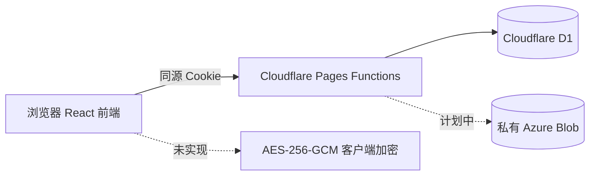

# CloudHub 工程安全笔记

这组笔记记录 CloudHub 当前认证基础、D1 本地/生产迁移边界、私密云盘安全审计结论，以及后续客户端端到端加密（E2EE）设计。

> [!IMPORTANT]
> 当前仓库已经实现双固定用户认证，但文件上传、Azure Blob、文件授权和 E2EE 都还没有实现。设计建议不能视为已经具备的安全能力。

## 阅读导航

| 文档 | 内容 |
| --- | --- |
| [当前架构与认证实现](./01-current-architecture.md) | 当前已经存在的代码、数据表、API 和安全边界 |
| [安全审计与风险清单](./02-security-audit.md) | 风险分级、已修复问题、未实现风险和检查结论 |
| [E2EE 加密方案](./03-e2ee-design.md) | AES-256-GCM、密钥层级、分块格式、恢复与分享设计 |
| [D1 与生产运维手册](./04-d1-operations.md) | 本地迁移、生产迁移前核对、账号初始化和禁止事项 |
| [阶段路线图与测试矩阵](./05-roadmap-and-tests.md) | 从认证加固到私密云盘上线的实施顺序和测试要求 |
| [本地 D1 集成测试记录](./06-local-d1-integration-testing.md) | 真实本地 SQL、限流边界、并发测试和验证范围 |
| [登录闭环与应用主框架](./07-authenticated-workspace.md) | 前端认证状态、会话恢复、工作台模块和验证边界 |
| [私有云盘目录元数据](./08-private-drive-metadata.md) | 文件元数据、目录 API、所有权和当前未实现范围 |

## 当前状态一览

### 已实现

- Cloudflare Pages Functions
- D1 健康检查
- 两个预先创建账号的认证模型
- PBKDF2-HMAC-SHA-256 密码哈希
- HttpOnly、Secure、SameSite=Strict 会话 Cookie
- D1 会话令牌哈希存储
- 登录失败限流
- login、me、logout、logout-all API
- 本地 D1 迁移和测试
- 认证响应 `Cache-Control: no-store`
- 基础 Pages 安全响应头
- 前端登录、会话恢复、退出和认证后工作台原型
- 文件/目录元数据、目录列表和目录创建 API（本地 D1）

### 未实现

- 用户注册
- 文件上传、下载、删除
- 文件/文件夹权限
- 分享授权
- Azure Blob 接入
- SAS 生成
- 客户端 E2EE
- 恢复密钥
- 文件级密钥轮换
- 浏览器端自动化认证回归测试
- Azure Blob 存储键生成和文件内容存储

## 重要原则

1. 未经人工确认，不执行生产 D1 迁移。
2. 不把密码、Cookie、Azure 密钥、SAS 或公司文件内容放入 Git、日志或前端变量。
3. 每个未来文件 API 都必须在服务端重新校验当前用户和资源权限。
4. 不把客户端隐藏按钮当作权限控制。
5. E2EE 设计完成前，不把普通认证描述成文件内容加密。
